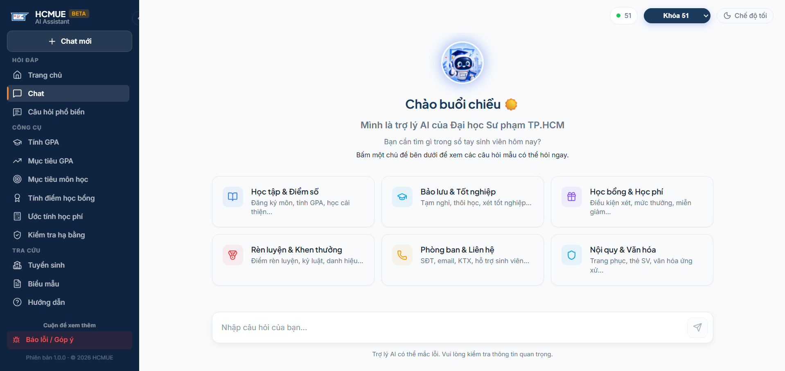
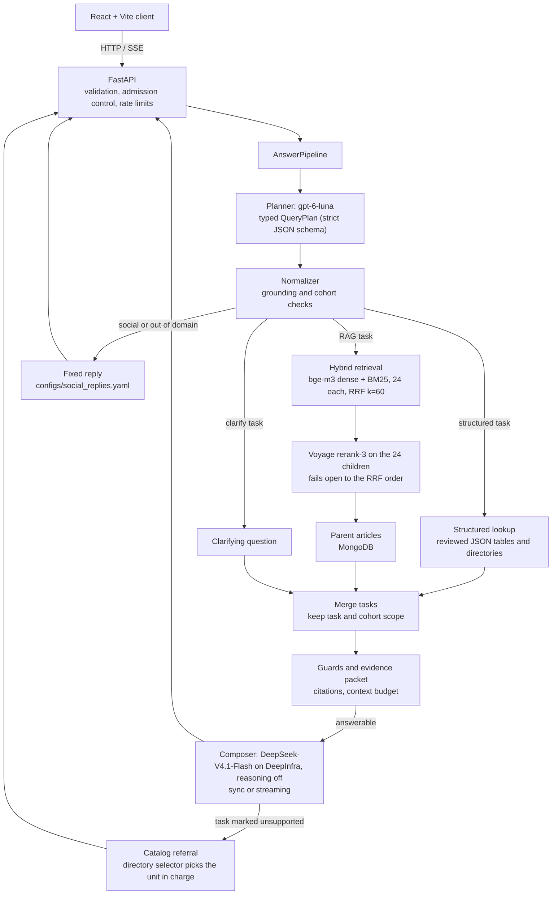
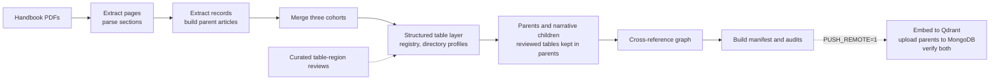

<div align="center">
  
  <h1>HCMUE AI — Student Handbook Assistant</h1>
  <p><strong>A cohort-aware RAG assistant for the student handbooks of Ho Chi Minh City University of Education (K49, K50, K51).</strong></p>
  <p>LLM query planning · deterministic plan validation · structured table lookup · hybrid retrieval with citations · streaming React UI</p>
  <p>
    <a href="https://hcmuebot.id.vn"></a>
    <a href="https://anhfeee-hcmue-handbook-rag-api.hf.space/docs"></a>
  </p>
  <p>
    <a href="https://github.com/AnhPhiNe/student-handbook-rag-chatbot/actions/workflows/ci.yml"></a>
    
    
    
    
    
    <a href="./LICENSE"></a>
  </p>
</div>

<p align="center">
  
</p>

> [!IMPORTANT]
> HCMUE AI is an independent student project, not an official application of the university. Check the cited handbook article or the responsible office before making an important academic decision.

## Contents

1. [Overview](#overview)
2. [Highlights](#highlights)
3. [Architecture](#architecture): [request lifecycle](#request-lifecycle), [a query plan in practice](#a-query-plan-in-practice)
4. [Design decisions](#design-decisions)
5. [Knowledge base](#knowledge-base)
6. [Evaluation](#evaluation)
7. [Getting started](#getting-started)
8. [API](#api)
9. [Frontend](#frontend)
10. [Operations and security](#operations-and-security)
11. [Project structure](#project-structure)
12. [Deployment](#deployment)
13. [What the evidence supports, and what comes next](#what-the-evidence-supports-and-what-comes-next)
14. [Documentation](#documentation)
15. [License](#license)

## Overview

Each cohort at HCMUE receives its own student handbook: a long PDF of regulations, procedures, grading and scholarship tables, tuition rules and office directories. The rules differ between cohorts, the tables are hard to search, and students ask in informal Vietnamese, often without diacritics, and often several things at once.

HCMUE AI answers those questions from the three handbooks, K49, K50 and K51, and cites the article it used. An LLM **plans** each question as typed tasks; deterministic code **checks** that plan and **executes** it. Exact values come from reviewed tables. Explanations come from retrieved handbook articles. A second LLM writes the final answer only from that evidence.

| Question type | Example (Vietnamese) | How it is answered |
|---|---|---|
| Table fact | *K51: IELTS 6.0 tương đương bậc mấy?*<br/><sub>which CEFR level does IELTS 6.0 map to</sub> | Structured lookup in the foreign-language equivalency table; the exact value is passed to the writer as a fact lock |
| Directory | *Phòng Đào tạo ở đâu, email là gì?*<br/><sub>where is the Academic Affairs office, what is its email</sub> | Office directory lookup by name or alias |
| Regulation or procedure | *Muốn bảo lưu kết quả học tập cần điều kiện gì?*<br/><sub>what is required to defer one's studies</sub> | Hybrid retrieval over handbook articles, answered with citations |
| Several requests | *Học phí K51 thế nào và học bổng loại giỏi cần bao nhiêu điểm?*<br/><sub>what is K51 tuition, and what score does a merit scholarship need</sub> | One task per request, merged into a single answer |
| Missing information | *Điểm của em được xếp loại gì?* (no score given)<br/><sub>what classification does my grade fall into</sub> | A clarifying question for the missing value |
| Not in the handbook | *Quên mật khẩu email sinh viên thì làm sao?*<br/><sub>I forgot my student email password</sub> | The handbook says nothing, so a fixed reply names the unit in charge with its catalog contacts |
| Greeting or thanks | *Xin chào*, *cảm ơn nhé*, *bạn là ai?* | A fixed friendly reply, no search |
| Out of scope | *Hôm nay trời mưa không?*<br/><sub>is it raining today</sub> | A short reply saying what the assistant covers |

The web app also includes a GPA calculator, credit and tuition tools, scholarship rules, downloadable forms and a student survival guide.

## Highlights

- **The LLM plans and the code verifies.** OpenAI `gpt-6-luna` returns a `QueryPlan` under a strict JSON schema: tasks, lookup type, slots, cohorts and clarification needs. A deterministic normalizer checks every slot against the student's own words, checks lookup types and cohorts against the registry, and turns a task it cannot trust into a clarifying question or a RAG task. Values that select a table row or a fact must appear in the question; a unit or program name may be the planner's reading of the words the student typed, because the directory selector still has to find it in that cohort's closed list. The plan is never trusted blindly.
- **Exact facts come from tables, not from generation.** Nine lookup capabilities run over reviewed JSON catalogs: grading scales, foreign-language equivalency, scholarship classification, study duration, formulas, and office, faculty, program and student-service directories. A unique match becomes a `resolved_result` that the writer is instructed to keep verbatim.
- **Hybrid retrieval.** `BAAI/bge-m3` dense search in Qdrant (embeddings from the DeepInfra API) and in-process BM25 each return 24 children, fused with reciprocal rank fusion (k = 60). Voyage `rerank-3` reorders those 24, and the children are grouped into their full parent articles from MongoDB (top 5). An offline cross-reference graph adds related-article links for the UI.
- **Cohort isolation end to end.** Every task runs per cohort, and retrieved sources and citations are filtered to the cohort that was asked for.
- **Graceful degradation.** Each provider has a quota-aware key pool with per-key RPM, TPM and daily limits that honors the provider's retry hints. Reranking fails open to the RRF order, and a failed query embedding leaves BM25 serving alone. A planner failure falls back to a safe RAG plan. Admission control allows 3 concurrent requests, a queue of 10 and a 30 s wait, with a configurable per-client rate limit.
- **Reproducible data.** One command rebuilds the corpus from the PDFs, and the rebuild is byte-for-byte deterministic. A build manifest of hashes, counts and target collections ties the Qdrant and MongoDB contents to one build ID.
- **Frozen evaluation harness.** Four suites run over a hand-authored, source-anchored dataset. Every run records the git commit, the dataset hash and the model and prompt versions it measured.

## Architecture



**Reading the diagram**, two things that are easy to misread:

- **The normalizer, not the planner, decides what actually runs.** The planner is an LLM
  and is treated as untrusted: it proposes a typed plan, and the normalizer validates
  every task against the question text and the lookup registry before a single lookup
  executes.
- **Every branch out of the normalizer can end without a composer call.** A clarify
  task, an out-of-domain question, a greeting, or a request where nothing is answerable returns an
  explicit status and never reaches the composer - what keeps a wrong-but-fluent answer from
  being generated in the first place.

### Request lifecycle

1. **Receive.** The API validates the question, the selected cohort and the recent conversation history, then admits the request.
2. **Plan.** The planner reads the student's own words and splits the question into typed tasks. The normalizer validates and canonicalizes that plan before anything runs; slang rewriting is applied to retrieval queries.
3. **Execute.** Each task runs per cohort. Structured tasks read reviewed tables and directories. RAG tasks retrieve narrative chunks, rerank them and expand them to full articles. Clarify tasks carry the question to ask.
4. **Guard.** Task results are merged without mixing cohorts. If nothing can be answered, the request stops with an explicit status and no composer call.
5. **Compose.** The evidence packet goes to the DeepSeek composer. The model answers the covered tasks and asks for anything missing.
6. **Deliver.** The same prepared answer is returned as JSON (`/chat`) or streamed as server-sent events (`/chat/stream`), with citations, structured results and related-article links.

| Situation | Outcome |
|---|---|
| The whole request lacks a required value | `needs_clarification`, with no composer call |
| The question is outside the handbooks | `out_of_domain`, a fixed reply, with no composer call |
| A greeting, thanks or a question about the assistant | `social`, a fixed reply, with no composer call |
| A task has no evidence in the handbook | The composer marks it; if the catalog names the unit in charge, a labelled referral with its contacts is added. When every task is marked and matched, the reply is that referral alone |
| Only part of a compound question is answerable | The answered parts plus a question about the missing part |
| No key is available or the provider fails | An explicit error status; failures are never cached |
| The reranker is unavailable or slower than 10 s | The original RRF order is used and the request continues |
| The query embedding fails | BM25 candidates alone go through reranking; the request continues |

### A query plan in practice

For *"K51: IELTS 6.0 tương đương bậc mấy? Và muốn bảo lưu kết quả học tập cần điều kiện gì?"* (what CEFR level IELTS 6.0 maps to, and what is required to defer one's studies), the planner returns two tasks:

```json
{
  "context_mode": "standalone",
  "out_of_domain": false,
  "tasks": [
    {
      "id": "t1", "mode": "structured", "intent": "direct_value",
      "lookup_type": "foreign_language",
      "question": "IELTS 6.0 tương đương bậc mấy?",
      "slots":      {"certificate_or_language": "IELTS", "score_or_level": "6.0"},
      "slot_spans": {"certificate_or_language": "IELTS", "score_or_level": "6.0"},
      "cohorts": ["K51"], "clarification_question": null
    },
    {
      "id": "t2", "mode": "rag", "intent": "open_question", "lookup_type": null,
      "question": "Muốn bảo lưu kết quả học tập cần điều kiện gì?",
      "slots": {}, "slot_spans": {},
      "cohorts": ["K51"], "clarification_question": null
    }
  ]
}
```

`t1` reads the K51 foreign-language equivalency table and locks the result: IELTS 6.0 falls in the 5.5–6.5 band, which is level 4 (`matched_level: bac_4`). `t2` retrieves the K51 regulation on deferring studies. Both results go into one evidence packet and one answer. If the planner had written `"score_or_level": "7.0"`, a score the student never typed, the normalizer would drop it. The lookup would still return the IELTS row, but with no matched level, so the answer could not state a level for a score nobody asked about.

The planner, normalizer, structured lookup, retrieval, start-up and streaming paths are drawn step by step in [docs/ARCHITECTURE.md](docs/ARCHITECTURE.md), with a code map of the functions a request meets.

## Design decisions

| Decision | Alternative | Why |
|---|---|---|
| The planner emits a typed plan; code validates and executes it | A free-form tool-calling agent | Every step can be inspected and unit-tested, and an invented value never becomes a stated fact: numbers must come from the question, and a unit name must exist in that cohort's catalog |
| Exact values come from reviewed tables and are locked into the prompt | Letting the writer read tables from retrieved text | PDF tables flatten badly, and grades or equivalencies must be exact |
| Small children are embedded; answers use full parent articles | Embedding whole articles | Precise matching plus complete context for the writer |
| Dense and BM25 are fused with RRF | Dense search only | Exact terms such as certificate names, cohort codes and article numbers need lexical matching |
| The reranker is optional and fails open | A mandatory reranker | A provider limit should cost ranking quality, not the answer |
| Embeddings and reranking run behind an API | Models loaded in the container | The free Space has no GPU; an API keeps the container small and serves several students at once |
| Separate models for planning and writing | One large model for both | Each role has a narrow contract; a small fast planner keeps latency and cost down |
| A frozen, source-anchored benchmark with run snapshots | Ad-hoc spot checks | Every change is compared on identical cases against a recorded runtime |

## Knowledge base

| Artifact | Build `973ef632` (2026-10-18) | Used for |
|---|---:|---|
| Full parent articles | 561 | Composer context and citations (MongoDB) |
| Narrative child chunks, one per clause (*khoản*) | 2,688 | Dense and BM25 search (Qdrant) |
| Table descriptions | 32 | Dense and BM25 search; a match brings in its reviewed table |
| Reviewed structured tables | 35 | Deterministic lookup (not embedded) |
| Cross-reference edges | 78 | Related-article navigation in the UI |
| Embedding | `BAAI/bge-m3`, 1,024 dimensions | Dense child retrieval |

Per cohort: K49 has 169 parents and 820 children, K50 has 192 and 911, and K51 has 200 and 957. The K49 cohort replaced K48–K49 on 2026-10-18: that cohort had been built from the K48 handbook (2022 – 2023) alone, and K48 students have graduated. Its collections are `student_handbook_table_search_3bbd93e9f05a` (children and table descriptions) and `parent_docs_table_search_3bbd93e9f05a` (parents); the suffix is a hash of the build and its table descriptions, recorded in the candidate manifest, so a collection name always identifies one build. They were published and verified on 2026-10-18 (2,720 vectors, 561 parents, no mismatch) and serve production since that day. A clause with its lead-in and points is one chunk, never split; [`check_chunk_invariants.py`](scripts/check_chunk_invariants.py) fails the build if a line is lost, a chunk starts or ends mid-sentence, or a list leaves its lead-in. The search index covers what applies to full-time (*chính quy*) university students of the main campus (District 5): articles for part-time study, the college programme and staff only get no search chunk ([`corpus_scope.yaml`](configs/corpus_scope.yaml)), and branch-campus units are left out of the directories. Counts, hashes and the target collections are recorded in [`build_manifest.json`](data/processed/metadata/build_manifest.json).

### Offline build



Tables live in two places. Parent articles keep them as readable Markdown for the writer, and the structured registry keeps them as JSON for lookup. Narrative children exclude reviewed table regions so that table rows do not crowd out prose in search.

Rebuild locally without touching the remote stores:

```bash
PUSH_REMOTE=0 python -m scripts.build_multi_cohort \
  --qdrant-collection <qdrant_collection> --mongo-collection <mongo_collection>
python -m scripts.structure_chunking --publish-artifacts
python -m scripts.build_artifact_manifest \
  --qdrant-collection <qdrant_collection> --mongo-collection <mongo_collection>
```

The first command overwrites `data/processed/`, so run it in a clean worktree; the second replaces the children with one chunk per clause and checks the chunk invariants, and the third writes the manifest. The only inputs are the PDFs in `data/raw/`, the reviewed configs and `data/curated/` (the reviewed table regions and, per handbook, the index of its articles in `article_index/<cohort>.csv`); two runs give the same bytes. With `PUSH_REMOTE=1` it also preflights the target collections, embeds and uploads, then verifies the remote contents against the manifest. The collection names are only recorded in the manifest. Production collections are published from a frozen candidate with `scripts.build_table_search_candidate` and `scripts.publish_table_search_candidate`, which always write new collections. See the [parent/child build contract](docs/PARENT_CHILD_BUILD_CONTRACT.md) and the [script index](scripts/README.md).

## Evaluation

Hand-authored datasets, every expected answer anchored to a handbook source.
`official_v4` (246 questions, 228 in scope) measures answer quality and is used
for every change since 2026-09-30; each run is pre-registered in
[SPEC.md](data/eval/official_v4/SPEC.md) before it is read. `official_v1` (the
development set) and `official_v2` (a spent hold-out) measure the planner and
retrieval. Answers are scored by a pinned LLM judge (`openai/gpt-oss-120b`).

| Run | Date | System | `answer_correctness`, 228 in scope |
|---|---|---|---:|
| K49 | 2026-10-18 | K49 handbook; composer v3.36 | K49 0.960, K50+K51 0.975 |
| Q | 2026-10-19 | Composer v3.43 on DeepInfra | 0.964 |
| S | 2026-10-19 | Composer v3.44 with catalog referral | **0.972** (paired +0.008, CI [−0.006, +0.023] against Q) |

Runs Q and S reuse run K49's planner decisions, so they isolate the composer.
**Not yet measured end to end:** the deployed combination of planner v63d,
normalizer v36, composer v3.44, the referral template and the social replies.
The template and the social replies are validated on development sets and
probes only. official_v4 is not a hold-out, its questions are synthetic, and
the judge has no measured agreement with a human rater.

- Run details: [RESULTS.md](data/eval/official_v4/RESULTS.md).
- Datasets, suites, commands and the 2026-09-12 hold-out result:
  [docs/EVALUATION.md](docs/EVALUATION.md).
- Component switches for ablations: [docs/EXPERIMENTS.md](docs/EXPERIMENTS.md).

## Getting started

### Prerequisites

- Python 3.11 and Node.js 20
- A Qdrant collection and a MongoDB database loaded from the current build (see [Offline build](#offline-build))
- API keys for OpenAI (planner), DeepInfra (composer, directory selector and BGE-M3 embeddings) and Voyage (the rerank-3 reranker). LangSmith (tracing) is optional.

### Backend

```bash
python3.11 -m venv .venv
source .venv/bin/activate          # Windows: .\.venv\Scripts\Activate.ps1
python -m pip install -r requirements-dev.txt
cp .env.example .env               # then fill in the values below
python -m uvicorn src.api.main:app --reload
```

Interactive API docs are then served at `http://127.0.0.1:8000/docs`.

| Variable | Required | Purpose |
|---|:---:|---|
| `QDRANT_URL`, `QDRANT_API_KEY`, `QDRANT_COLLECTION_NAME` | yes | Vector store for narrative children |
| `MONGODB_URL`, `MONGODB_DB_NAME`, `MONGODB_PARENT_COLLECTION` | yes | Parent articles |
| `OPENAI_API_KEY` | yes | Planner (`gpt-6-luna`, strict QueryPlan schema; settings in `configs/ai_router.yaml`) |
| `GROQ_API_KEYS` | no | Evaluation judge only |
| `DEEPSEEK_API_KEY` | no | Only the experiment configs in `configs/experiments/` that call the DeepSeek API directly |
| `DEEPINFRA_API_KEY` | yes | Composer (`llm`, DeepSeek-V4.1-Flash), the directory selector, which picks the service, office, faculty or program a student names when no name matches exactly and the unit a catalog referral names (`directory_selector`; both in `configs/answer_generation.yaml`), and BGE-M3 query and document embeddings |
| `VOYAGE_API_KEY` | yes | The Voyage `rerank-3` reranker (`configs/retrieval.yaml`); a reranker failure keeps the RRF order |
| `LANGSMITH_TRACING`, `LANGSMITH_API_KEY`, `LANGSMITH_PROJECT` | no | Request tracing and user feedback |
| `STUDENT_RAG_CORS_ORIGINS` | no | Comma-separated browser origins allowed to call the API (needed when the frontend is on another domain) |
| `STUDENT_RAG_ADMIN_API_KEY` | no | Enables `/health/artifacts` through the `X-Admin-API-Key` header |
| `STUDENT_RAG_RATE_LIMIT_PER_MINUTE`, `STUDENT_RAG_MAX_CONCURRENT_CHAT`, ... | no | Admission and rate-limit overrides |

[`.env.example`](.env.example) lists every setting with its default. Keep `.env` out of version control.

### Frontend

```bash
cd frontend
npm ci
npm run dev        # set VITE_API_BASE_URL to your backend
```

### Docker

```bash
docker build -t hcmue-rag .
docker run -p 7860:7860 --env-file .env hcmue-rag
```

The image runs one Uvicorn worker on port 7860, the same setup as the Hugging Face Space.

### Tests and checks

```bash
python -m pytest tests                   # unit and contract tests (no network)
python -m ruff check src tests --select E,F --ignore E402,E501
python scripts/check_deploy_artifacts.py # required runtime files and build manifest
```

The test suite covers the API contracts, planner prompt and normalizer, every structured lookup, retrieval fusion and reranking, the key pools, the build scripts and the evaluators. No test needs network access or API keys. CI runs these checks, plus the frontend lint and build, on every push and pull request to `main`.

Behavior-preserving refactors are also checked with an equivalence test: a byte-for-byte rebuild of `data/processed/` for build code, an offline regrade of saved evaluation runs for evaluators, or a fake-provider comparison for provider clients.

## API

| Method | Path | Description |
|---|---|---|
| `POST` | `/chat` | Answer a question and return JSON |
| `POST` | `/chat/stream` | The same answer as server-sent events: `queued`, `progress`, `metadata`, `token`, `done`, `error` |
| `POST` | `/chat/feedback` | Thumbs up or down on an answer (`run_id`, `score`, optional `comment`) |
| `GET` | `/health` | Liveness |
| `GET` | `/health/readiness` | Qdrant, MongoDB, BM25 and artifact readiness |
| `GET` | `/health/artifacts` | Required files and configuration (admin key required) |
| `GET` | `/api/metrics/visits` | Visitor counter kept in MongoDB |

```bash
curl -X POST http://127.0.0.1:8000/chat \
  -H "Content-Type: application/json" \
  -d '{"query": "IELTS 6.0 tương đương bậc mấy?", "cohort": "K51"}'
```

The response carries `answer`, `status` (`answered`, `needs_clarification`, `out_of_domain`, `social`, `low_confidence`, ...), `citations`, `structured_results` and `related_references`.

## Frontend

The React 19 + TypeScript client ([`frontend/`](frontend)) is a mobile-first single-page app:

- **Chat.** A cohort picker, answers streamed token by token over SSE, citations that open the source article, structured results rendered as tables, related-article links, and thumbs-up or thumbs-down feedback.
- **Status.** A badge reads `/health/readiness`, so users can see when the backend is degraded.
- **Tools.** A GPA calculator, a target-GPA planner, credit and tuition helpers, scholarship rules, downloadable forms and a student survival guide. These run in the browser and need no API calls.

Conversation history lives in the browser's `sessionStorage` and is sent with each request; the server does not store chats.

## Operations and security

| Concern | Implementation |
|---|---|
| Admission control | At most 3 chats at a time, a queue of 10 and a 30 s wait; beyond that, HTTP 503 for `/chat` or a `server_busy` event for `/chat/stream` |
| Rate limits | Code defaults are 5 requests per minute per client, 120 per minute per IP and a 2,000-character question limit, all overridable; the shipped `.env.example` raises the per-client limit to 20/min and keeps the 2,000-character limit. Rate-limit rejection returns HTTP 429 with `Retry-After`; an oversized question returns HTTP 400 without truncation |
| Provider quotas | One `KeyPool` per provider rotates keys under per-key request, token and daily limits and cools a key down after a 429 |
| Caching | A router cache for plans only. Answers are not cached: exact repeats were 4 of 78 real requests, and a cached reply defeated the regenerate button |
| Observability | One LangSmith trace per request, with child runs and token usage for the planner and the composer; feedback is attached to the same run |
| Health | `/health` for liveness, `/health/readiness` for Qdrant, MongoDB, BM25 and artifacts, and an admin-only `/health/artifacts` |
| Cold start | `STUDENT_RAG_WARMUP_ON_STARTUP` (set by the Dockerfile) builds the pipeline and the BM25 index on a background thread at boot, so the first question costs what the second does. Off by default locally, so a shell or a test run builds nothing it does not use |
| Secrets | Keys are read from environment variables only; key-pool state and logs store a SHA-256 fingerprint, never the key itself |
| Privacy | The server keeps no chat log. With LangSmith tracing on, questions and answers are sent to LangSmith |

## Project structure

```text
├── configs/                  # Runtime, build and evaluation settings (index: configs/README.md)
├── data/
│   ├── raw/                  # Source handbook PDFs
│   ├── curated/              # Reviewed table regions and corrections
│   ├── processed/            # Versioned build output: parents, children, tables, graph, manifest
│   ├── eval/official_v1/     # Development set, plus the production-suite results
│   ├── eval/official_v2/     # Spent hold-out, now a regression set
│   ├── eval/official_v3/     # Archived (still on the retired K48-K49 cohort)
│   ├── eval/official_v4/     # Answer-quality benchmark: SPEC (pre-registrations) and RESULTS
│   └── eval/development/     # Small probe sets, one per feature
├── src/
│   ├── api/                  # FastAPI routes, schemas, admission control, health checks, startup warm-up, tracing
│   ├── services/             # Shared AnswerPipeline lifecycle
│   ├── generation/           # Pipeline orchestration, plan executor, evidence packet, prompts, DeepSeek client
│   ├── retrieval/core/       # Planner, normalizer, structured lookups, embedding client, hybrid retrieval, reranker
│   ├── retrieval/vectorstore/# MongoDB parent store
│   ├── common/               # Cohorts, text folding, key pool, I/O and config helpers
│   ├── ingestion/            # PDF loading and cross-reference graph
│   ├── preprocessing/        # Handbook structure parsing
│   ├── extraction/           # Structured-record extraction
│   ├── chunking/             # Parent article construction
│   └── evaluation/           # Suites: deterministic, retrieval, answers, production
├── scripts/                  # Build, publish, evaluation and deploy entry points (index: scripts/README.md)
├── frontend/                 # React 19 + TypeScript + Vite client
├── tests/                    # Unit, contract and regression tests
└── docs/                     # Architecture, evaluation, experiments, design decisions (index: docs/README.md)
```

A suggested reading order for the backend: [`schemas.py`](src/api/schemas.py), then [`answer_pipeline.py`](src/generation/answer_pipeline.py), [`ai_router.py`](src/retrieval/core/ai_router.py), [`query_plan.py`](src/retrieval/core/query_plan.py), [`structured_dispatcher.py`](src/retrieval/core/structured_dispatcher.py) and [`hybrid_pipeline.py`](src/retrieval/core/hybrid_pipeline.py), and finally [`prompt_builder.py`](src/generation/prompt_builder.py). Read the matching tests alongside each file.

| Configuration | Controls |
|---|---|
| [`ai_router.yaml`](configs/ai_router.yaml) | Planner model, output budget and key-pool limits |
| [`answer_generation.yaml`](configs/answer_generation.yaml) | Composer model, directory selector and key-pool limits |
| [`retrieval.yaml`](configs/retrieval.yaml) | Embedding model, top-k and reranker settings |
| [`structured_lookup_registry.yaml`](configs/structured_lookup_registry.yaml) | Lookup capabilities, slots and aliases shown to the planner |
| [`hcmue_slang_dictionary.yaml`](configs/hcmue_slang_dictionary.yaml) | Student slang and abbreviation normalization |

The functions a request meets, layer by layer, are listed in the [code map](docs/ARCHITECTURE.md#code-map).

## Deployment

| Part | Hosting | Notes |
|---|---|---|
| Frontend | Vercel ([hcmuebot.id.vn](https://hcmuebot.id.vn)) | Static React build; `/api/visits` is proxied to the backend |
| Backend | Hugging Face Spaces (Docker) | One worker; runtime files come from an explicit allowlist |
| Vector store | Qdrant | Collection `student_handbook_table_search_3bbd93e9f05a` (build `973ef632`) |
| Documents | MongoDB | Collection `parent_docs_table_search_3bbd93e9f05a` |

[`deploy_hf_backend.ps1`](scripts/deploy_hf_backend.ps1) packages only the allowlisted runtime files and checks that the build manifest targets the intended collections. `-DryRun` validates the package without touching the Space. Pass `-CandidateArtifacts <published candidate folder>` so the target collections come from its manifest. After a deploy, check `/health/readiness` and ask a few known questions. To roll back, point the Space back at its previous commit; the earlier collections are kept.

## What the evidence supports, and what comes next

Every claim above is backed by a specific run on a specific commit. This is where that
evidence stops, and what would extend it.

| Where the evidence stops | What would close it |
|---|---|
| **Few baselines.** Component ablations on the development set (planner models, composers, directory selection, embeddings, rerankers, BM25, candidate depth) are in [DESIGN_DECISIONS.md](docs/DESIGN_DECISIONS.md), but nothing yet compares the typed-plan design against plain RAG or a long-context model given the whole handbook. | Run those two baselines on the hold-out for the paper. |
| **The hold-out is spent.** `official_v2` produced one hold-out measurement; reading its failure informed a fix, so every later run of it is a regression check on a seen set. `official_v4` has guided changes since its first runs. | A fresh bundle, frozen before any code sees a result from it. |
| **The deployed combination is unmeasured.** Planner v63d, normalizer v36 and composer v3.44 were each checked, but never together on `official_v4`. | One end-to-end run against run K49. |
| **Some ablations need switches.** Plain RAG, no normalizer, no structured lookups, BM25 only and dynamic k cannot be run without code ([list](docs/EXPERIMENTS.md#missing-switches-for-a-paper)). | Add each as a flag that defaults to production behaviour. |
| **The judge is unvalidated.** Every quality score comes from an LLM judge with no measured agreement to a human rater. | A sample double-scored by a person, compared to the judge. |
| **Neither dataset is real traffic.** Both were written from handbook content in student phrasing, so the reweighted score's slice mix is an estimate. | A closed beta with real students; slice weights refit to the observed query mix. |
| **Production gates measure the wrong baseline.** Three of the five failing release gates were calibrated on localhost, not the deployed Space. | Recalibrate the thresholds against the real deployment target — never lower them just to turn the run green. |
| **Scope.** The system answers from the three handbooks only — no formula calculation, no OCR on image-only tables, no outside knowledge. | Out of scope by design, not a gap to close. |

## Documentation

Start at [docs/README.md](docs/README.md). The main pages:

| Document | Content |
|---|---|
| [Architecture](docs/ARCHITECTURE.md) | Step-by-step diagrams of each path and the code map |
| [Experiments](docs/EXPERIMENTS.md) | Component versions, ablation switches, baseline runs |
| [Evaluation](docs/EVALUATION.md) | Datasets, suites, commands, the 2026-09-12 hold-out |
| [Design decisions](docs/DESIGN_DECISIONS.md) | Every model and component choice, with the measurements that decided it |
| [Structured execution contract](docs/STRUCTURED_EXECUTION_CONTRACT.md) | Lookup capabilities, fact locks and evidence rules |
| [Parent/child build contract](docs/PARENT_CHILD_BUILD_CONTRACT.md) | How parents, children and reviewed tables are built and validated |
| [Technical debt](docs/TECHNICAL_DEBT.md) | Known maintenance boundaries |

## License

The source code is released under the [MIT License](LICENSE). The handbook content and university regulations belong to their respective publishers.
