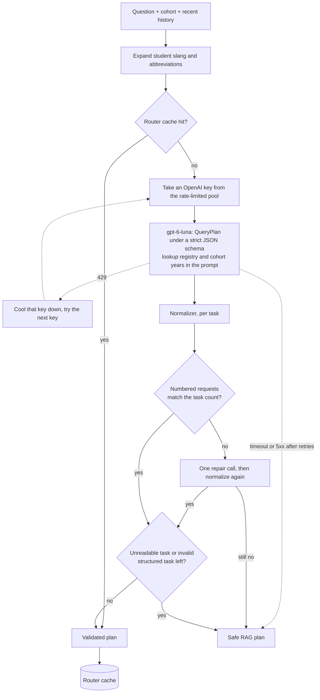
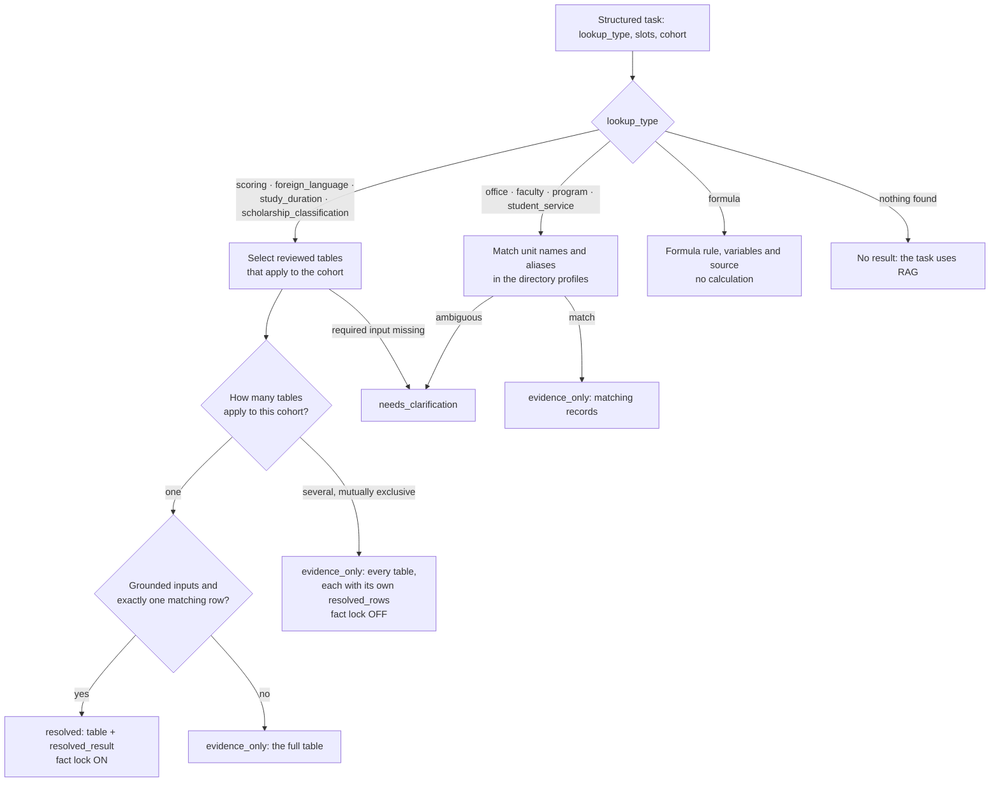
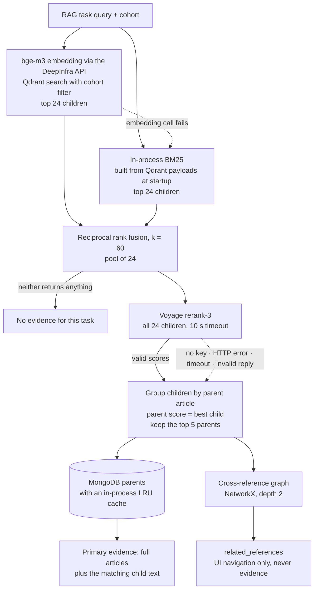
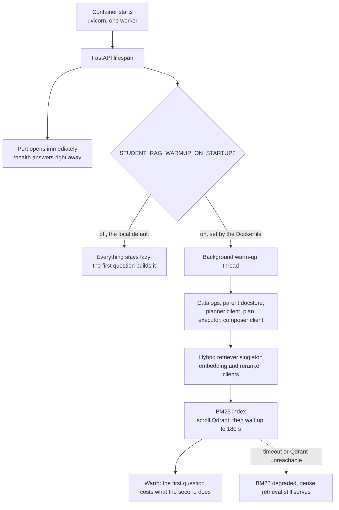
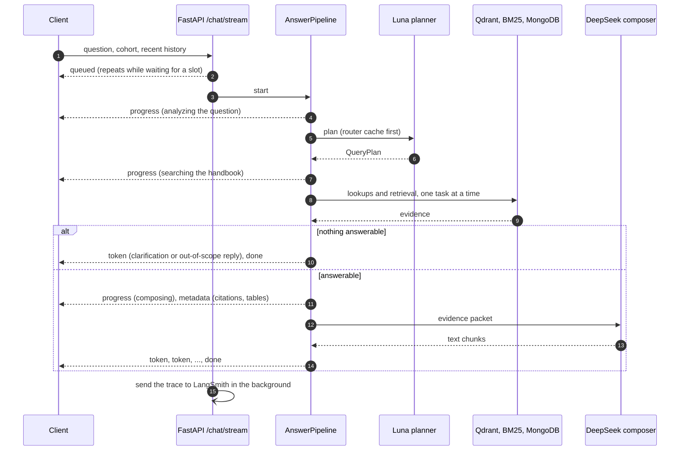

# Architecture deep dives

Moved out of the README on 2026-10-19 so the README stays an overview. The
diagrams describe the request path; component versions are in
[EXPERIMENTS.md](EXPERIMENTS.md#pipeline-components).

## Contents

1. [Query understanding: planner and normalizer](#query-understanding-planner-and-normalizer)
2. [Structured lookup](#structured-lookup)
3. [Retrieval](#retrieval)
4. [Container start](#container-start)
5. [One streaming request](#one-streaming-request)
6. [Code map](#code-map)

## Query understanding: planner and normalizer

What the normalizer does to each task:

| Check | Effect |
|---|---|
| A value that selects a row or a fact has no span in the question | The value is dropped; the lookup runs without it |
| A unit or program name differs from the span it quotes | Kept, as the planner's reading of the student's words; the span itself must still be in the question |
| A field choice is missing or outside its allowed values | The registry's `default_reading` is used where one is declared (a contact card shows every field, the program catalog resolves the faculty) |
| A required value the student never gave is missing | The task becomes a clarifying question that names what is missing (for a faculty, "Bạn cho mình biết tên khoa nhé." — tell me which faculty) |
| The lookup type is not in the registry | The task becomes a clarifying question |
| Any other structured-contract error | Only that task falls back to RAG; sibling tasks are kept |
| `out_of_domain` is set but the question uses handbook vocabulary | The flag is overridden and the question is answered from the handbook |

Every check writes its outcome to the trace as `plan_validation_errors` and
`plan_normalization_warnings`, so a changed plan carries its own reason.

## Structured lookup

The layer distinguishes three outcomes, and the distinction is the point:

- **One table, one row → `resolved_result`, fact lock on.** Inputs are grounded and
  exactly one row applies, so the system commits to a value; the composer is told to
  copy it verbatim, never re-read the table. The full table travels alongside it so the
  answer can explain the value in context.
- **Several tables apply → `resolved_rows` per table, fact lock deliberately off.** K51
  grades foundation and remaining courses on different scales, so 5.2 is a pass
  (*Đạt*) in one table and a fail (*Không đạt*) in the other. Without a grounded `course_scope`, the system
  cannot know which the student means, so it locks nothing and returns every applicable
  table - but it still resolves the matching row *inside each one*, rather than leaving
  the arithmetic to the composer. This exists because the composer once read the
  interval itself and reported a failing 5.2 as a pass. Picking which scope applies is
  semantics and stays with the composer; finding the row inside a scope is arithmetic
  and belongs to the resolver.
- **Nothing resolvable → `evidence_only` or a clarifying question.** Scoring is the only
  lookup where several applicable tables mean mutually exclusive answers. A scholarship
  question also returns several tables - amount, classification, eligibility, formula -
  but those are complementary facets with no single row to pick, so `resolved_rows` does
  not apply to them.

## Retrieval

Children are small, so matching stays precise; the writer always receives the full parent article, so the context stays complete. Scoring a parent by its best child means several matching children of one article do not push other articles out of the top 5. The `no_graph` and `vector_only` modes switch off the graph and BM25 for ablations, and `STUDENT_RAG_RERANKER_ENABLED=false` switches off reranking.

## Container start

Two properties here were learned by measuring the deployed Space, not by reasoning
about it:

- **Warm-up runs on a background thread, never in the startup path.** The container has
  to answer `/health` while the pipeline is still being built, or the platform health
  check fails and restarts it into a loop - so the port opens first and warming happens
  beside it. (This mattered most when the embedding model ran in the container; it now
  runs behind the DeepInfra API, so the image holds no model.)
- **It warms the retriever, not just the model.** An earlier version warmed the model,
  catalogs and clients but left the hybrid retriever lazy. Measured on the live Space: a
  structured question answered in 4.7 s, but the first RAG question took 23.3 s and the
  second took 6.9 s - the first one paid about 16 s to build the retriever and scroll
  Qdrant for the BM25 index. Warming the retriever too brought it to 7.5 s, matching the
  second.
- **It can only make startup slower, never broken.** BM25 is fail-open, so a timeout or
  an unreachable Qdrant leaves dense retrieval serving, and any exception is logged
  rather than propagated.

## One streaming request

`/chat` runs the same preparation and returns the finished answer as one JSON response.

## Code map

The functions a reader following a request would meet, in the order a request meets
them. Each one is the entry point of its layer; the modules hold the rest.

**Serving one question** — `src/services`, `src/generation`

| Function | What it does |
|---|---|
| `AnswerService.answer` · `.answer_stream` | One lazily built pipeline shared by the API and the UI. `warm()` builds up front what the first question would otherwise build itself. |
| `AnswerPipeline.prepare_answer` | The work both paths share: routing, retrieval, guardrails, prompt. The two paths then differ only in how they emit. |
| `PlanExecutor.run` · `.execute_task` · `.aggregate_results` | Runs at most three independent tasks, each across its cohorts, then merges them into one retrieval contract. |
| `is_context_empty` · `is_low_confidence` · `build_fallback_answer` | The last gate before generation: with no evidence, or evidence too weak, the composer is never called. |
| `StreamAnswerCleaner.feed` · `.finish` | Cleans the answer as it streams and holds back the tail, so a half-written marker never reaches the screen. |

**Planning and validating** — `src/retrieval/core`

| Function | What it does |
|---|---|
| `AIRouter.plan` | Asks the planner for a `QueryPlan` under a strict JSON schema, rotating keys and retrying within a bounded budget; a failure returns the safe RAG plan rather than an error. |
| `normalize_query_plan` | The deterministic gate. Current identity: `v36-social` (see `QUERY_PLAN_NORMALIZER_VERSION` in `query_plan.py`). |
| `grounding_text` · `visible_history_turns` | The student's own words, from the question and the history actually shown. A plan cannot cite what the model never saw. |
| `validate_structured_task` | Checks one task against its lookup contract: required slots, types, allowed values, and where each value came from. |
| `validate_fact_lock_inputs` | Lists the reasons a task must *not* pin a value. An empty list means it may, if its values select exactly one row. |
| `safe_rag_fallback_plan` | One bounded RAG task for when no plan can be trusted. |

**Retrieval** — `src/retrieval/core`

| Function | What it does |
|---|---|
| `ChildParentHybridRetriever.retrieve` | The whole hybrid path in one call: candidates, fusion, reranking, grouping into parents, graph neighbours. |
| `EmbeddingClient.embed_query` | BGE-M3 over the DeepInfra API, short timeout and one retry; on failure BM25 serves alone. |
| `BM25Retriever._tokenize` | Vietnamese segmentation with underthesea, identifiers and certificate names kept whole, and an unaccented twin for every token so unaccented questions still match. |
| `reciprocal_rank_fusion` | Fuses the two lists by rank alone, so two incomparable score scales can be combined. |
| `Reranker.rerank` | Voyage `rerank-3` over all 24 children. A missing key, timeout, HTTP error or malformed reply keeps the RRF order and records the reason. |
| `raw_table_for_handle` | A search hit opens its reviewed table only when table id, content hash, parent, cohort and document all match. |
| `build_related_references` | Builds the related-article cards for the UI. They never enter the prompt or the citations. |

**Structured lookup** — `src/retrieval/core`

| Function | What it does |
|---|---|
| `resolve_structured_task` | Dispatches to one of four families: reference tables, directories, the program catalog, formulas. |
| `exact_matches` | Records whose name or alias equals the text after folding; an exact hit needs no model call. |
| `DirectorySelector.select` | Otherwise asks the selector model to choose from that cohort's closed list, and asks again with reasoning on if the first pass finds nothing. |
| `parse_reply` | Validates the model's answer against the ids it was shown, so it cannot name a record that was not offered. |
| `is_validated_source_applicable` | Another cohort's source is evidence only where cross-cohort applicability was declared and verified at ingestion. |
| `collect_applicable_amendments` | Pulls the amendments that apply to the asked cohort, so a superseded clause is not answered as current. |

**Prompt and citations** — `src/generation`

| Function | What it does |
|---|---|
| `build_answer_prompt_bundle` | Builds the composer prompt and returns the exact evidence JSON it was given, so a trace shows what the model actually saw. |
| `build_authorized_evidence_packet` | Groups already-authorized evidence by task and cohort; nothing unauthorized can reach the packet. |
| `limit_context` | Trims to the character budget. On this corpus it never fires (the five longest parents total 54,427 characters against 120,000 usable). |
| `build_citations_from_vector_results` · `build_citation_from_lookup` | Citations for the retrieval branch and for the structured branch, both bound to their source. |

**Building the corpus** — `scripts`

| Function | What it does |
|---|---|
| `split_segments` | Rejoins the lines the PDF wrapped, then opens a segment at each marked line or table. |
| `unit_chunk` | The core rule: a clause, or an article without clauses, is one chunk. Never split. |
| `load_layout_fixes` | The 24 reviewed entries in `configs/layout_fixes.yaml`. Each one only groups lines; one that matches nothing fails the build. |
| `apply_scope` | Removes out-of-scope clauses from the search index. The parent text is untouched, so citations stay verbatim. |
| `context_header` | Builds the "document › chapter › article" line. It reaches the embedding and the reranker only, never the chunk text. |
| `check_chunk_invariants.check` | Reads each article's raw lines, not the chunker's output, and fails the build on a lost line, a cut sentence, a heading-only chunk, a stray column header or a list separated from its lead-in. |
| `build_table_descriptions` | One search handle per approved table, carrying field names and labels but no numbers. The numbers stay in the table. |
